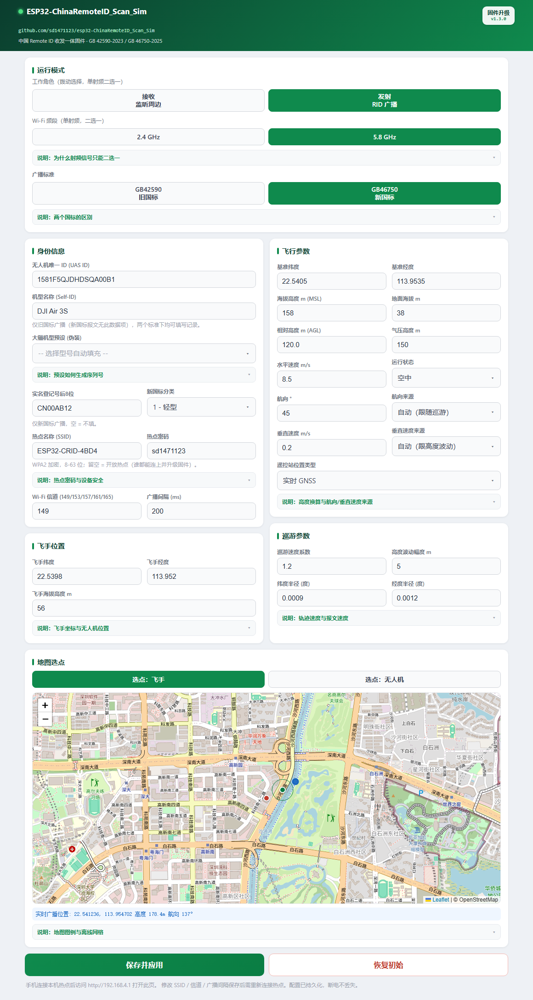
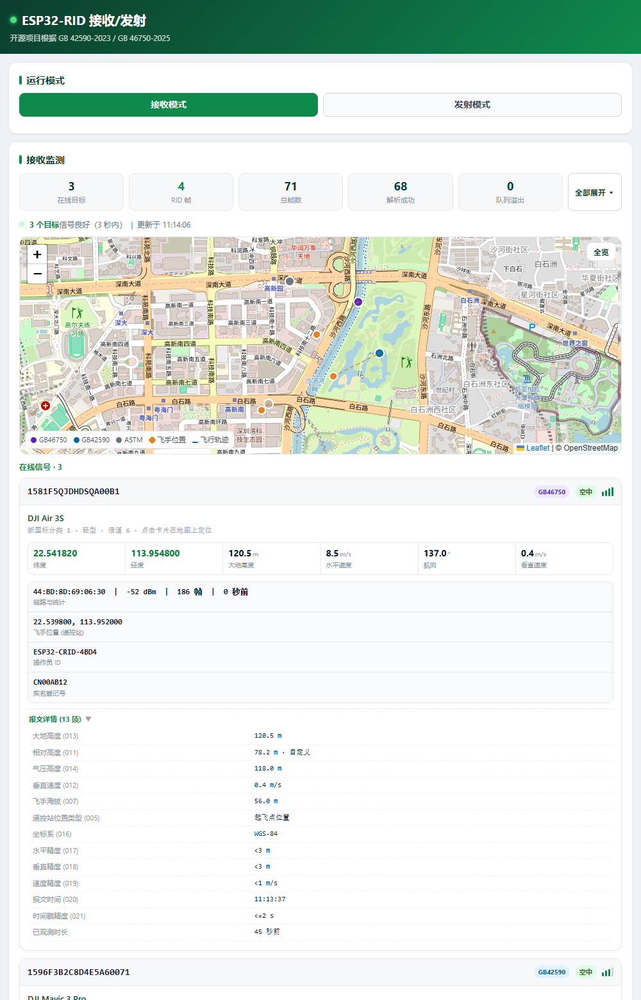

# ESP32-ChinaRemoteID_Scan_Sim

ESP32 无人机 Remote ID **广播（模拟）/ 接收（扫描）一体固件**，单程序双模式，网页在线配置。

- **发射模式**：模拟无人机 Remote ID 广播，支持 **GB 42590-2023（旧国标）/ GB 46750-2025（新国标）** 两档切换，同时兼容 ASTM F3411-22 与 ASD-STAN prEN 4709-002
- **接收模式**：Wi-Fi 混杂模式监听所在信道，同时解码 **GB 42590 / GB 46750 / ASTM** 三种协议的 RID 报文，网页实时展示周边无人机与飞手位置
- **单射频二选一**：一条射频链路同一时刻只能发或只能收，网页用「接收 / 发射」拨动开关切换，不会出现双开互相抢空口；热点本身常开，随时可连进来改参数
- **双频段（ESP32-C5）**：2.4 GHz / 5.8 GHz（国标 5.8G 段 5725–5829 MHz，信道 149–165）可网页切换；**编译期按芯片裁剪**——S3 等 2.4G-only 芯片编出的固件里射频层 5G 代码整体消失（连 `esp_wifi_set_band_mode` 符号都不存在），页面也自动隐藏 5.8G 选项
- **零编译配置**：手机/电脑连接设备热点，浏览器访问 `http://192.168.4.1` 即可修改全部参数并持久化（NVS 断电保持）

已在 **ESP32-S3** 与 **ESP32-C5**（均为 N16R8，16MB Flash）上实测；其他 4MB 以上 Flash 的 ESP32 模组可自行调整分区表编译。

## 界面预览

连接设备热点后访问 `http://192.168.4.1`，网页顶部可切换发射 / 接收模式（下图为 ESP32-C5 固件，
S3 固件不显示 5.8 GHz 选项）：

| 发射模式（C5 · 5.8 GHz 频段 · GB 46750 新国标） | 接收模式（监测扫描） |
|---|---|
|  |  |

## 功能总览

### 发射模式（模拟器）

- **双档广播标准**：GB 42590（OpenDroneID 打包报文）、GB 46750（位图数据项报文，17 项必选 + 011/012/014 三项可选），网页切换自动显隐对应配置项
- **稳定广播**：softAP 真实热点 + vendor IE 注入（OUI `FA:0B:BC`），硬件自动应答探测请求，手机 WLAN 列表稳定可见，无闪现/消失问题
- **双频段广播（C5）**：2.4 GHz / 5.8 GHz 二选一，切换后自动重建热点；2.4G 可选信道 1–13（默认 6）、5.8G 可选 149–165（默认 149，20 MHz 网格步进 4），并显式设置国家码 `CN`（默认 world-safe 会裁掉大部分 5G 信道）与 20 MHz 带宽
- **在线参数配置**：UAS ID、机型名称、机型代码（RID 标准 16 类航空器类别码）、操作员 ID、GPS 基准坐标、高度（海拔 / 地面海拔 / 相对高度 / 气压高度）、速度（水平 / 垂直）、**航向**、运行状态、**高度基准**、**遥控站位置类型**、巡游参数、热点 SSID/信道/广播间隔，保存即时生效
- **参数来源可选「自动 / 固定」**：航向与垂直速度可由巡游轨迹、高度波动自动推算，也可固定为指定值；**在数值框里直接输入即自动切到「固定」**，不会被 10 秒一轮的巡游悄悄改回去
- **大疆机型伪装预设**：内置 40 余款大疆主流机型（Mavic / Air / Mini / Avata / Neo / FPV / Matrice / Inspire / FlyCart 等），选型号自动生成符合真实格式的 20 位序列号并同步填入机型名称与机型代码
- **地图选点**：Leaflet + OpenStreetMap 点击/拖动选点自动填入坐标（WGS-84，与 RID 广播坐标系一致，无 GCJ-02 偏移）；支持独立设置飞手位置并与无人机位置联动；实时显示广播位置、**飞行轨迹（蓝线）**与巡游范围圈；无互联网自动降级离线网格拾取器
- **巡游路径模拟**：固定点或圆形巡游，半径/速度可调；巡游只改变位置、高度与航向，**报文里的「水平速度」始终等于「飞行参数」里填的值**（不会被巡游改写），页面会实时算出轨迹真实线速度供对照
- **高度模型**：`相对高度 (AGL) = 海拔 (MSL) − 地面海拔`，三个输入框任意改两个、第三个自动换算；巡游时的**高度波动幅度可调，填 0 即高度完全固定、垂直速度恒为 0**；相对高度会原样广播，不再被改写成「海拔 − 5」

### 接收模式（扫描器）

- **多协议解码**：ASTM F3411 / GB 42590 / GB 46750 报文全部解析（GB 46750 支持全部 21 个数据内容项）
- **实时监测页面**：卡片式列表展示周边 RID 信号，折叠态即为最紧凑的信息面——标题行是 **UAS ID + 标准 / 在线状态标签 + 信号柱**，下一行**左侧机型名、右侧链路与统计**（MAC · 信号强度 · 累计帧数 · 最后收到），再下是六格数值（经纬度 / 大地高度 / 水平速度 / 航向 / 垂直速度），以及**飞手位置与实名登记号并列一行**（操作员 ID 收进详情，不占卡面）；**在线 / 已离线分组显示**（10 秒无信号转入离线组，灰度置底，保留 30 分钟）；「报文详情」展开后列出该目标**收到的全部 32 项数据**，并支持**一键展开 / 折叠全部**；点击卡片可在地图上聚焦显示目标轨迹与飞手位置连线
- **双地图三态渲染**：联网时 Leaflet + OSM 地图；CDN 不可达或无互联网时自动降级为 canvas 离线网格底图（比例尺按目标包围盒自适应 1/2/5 档位）；完全无信号时显示空态提示
- **目标航迹**：每架无人机的历史位置绘制为地图轨迹线（在线实线、离线灰虚线），离线网格模式下同步绘制折线
- **飞手位置解析**：GB 46750 数据项 005/006/007 与 GB 42590 System 消息中的操作员坐标均可解析显示
- **一键导航**：卡片内「导航到无人机 / 导航到飞手」按钮，点击后弹出高德 / 百度二选一，选定即**直接唤起手机里已安装的地图 App**（高德 `amapuri://` / 百度 `bdapp://` 原生协议，iOS 走 `iosamap://` / `baidumap://`）进入驾车路线；目的地名称取机型（如 `DJI Air 3S`）与经纬度，坐标按 GNSS 原始 WGS-84 传递由 App 自行纠偏；只有 App 未安装（1.5 秒内没跳走）才退回网页版；无有效坐标的目标不显示按钮
- **频段跟随**：监听频段与信道跟随网页设置（C5 可切 5.8 GHz 监听），换信道/换频段前会先停掉混杂监听，避免驱动报错

### 网页与传输

- 响应式设计：电脑端（≥860px）双列卡片 + 大地图通栏，手机端单列自适应
- 内嵌页面与地图脚本以 **gzip 压缩**下发（约 30KB → 11KB），带禁缓存响应头
- 接收端地图脚本作为**独立资源按需懒加载**（`/rxmap.js`），与发射端地图零符号共享，单点故障不影响页面其余功能
- **网页内 OTA 升级**：页面底部选一个 `.bin` 即可换固件（裸流上传 + 进度条），双 app 分区轮换、镜像校验、断电保护、启动失败自动回滚，**不用数据线、不用装 ESP-IDF**

## 使用方法

1. 烧录固件后，手机连接热点 `ESP32-CRID-XXXX`（SSID/密码可在配置中修改）；
2. 浏览器打开 `http://192.168.4.1`；
3. 网页顶部拨动开关切换 **接收 / 发射**（单射频二选一，同一时刻只有一边生效）；发射模式下可切换广播标准（GB 42590 / GB 46750），ESP32-C5 还可切换 2.4 GHz / 5.8 GHz 频段
4. 修改 UAS ID、基准坐标（可地图选点）、高度、速度、巡游参数等，点击「保存并应用」即时生效；
5. 修改 SSID / 信道 / 广播间隔 / 频段后热点会重建，手机需重新连接（页面会提示，先回包再重建，不会报错）；
6. 「恢复初始」按钮一键还原全部默认配置（保留消息计数器，防止接收端乱序）；
7. 接收模式下，监听信道跟随「Wi-Fi 信道」设置（2.4 GHz 1–13、5.8 GHz 149–165，默认分别为 6 / 149）。
8. 固件升级：页面最下方「固件升级 (OTA)」选择 `remoteid_scanner.bin` 上传，设备写入另一个 app 分区、校验通过后自动重启（详见上一节）。

## 构建与烧录

### Windows 一键构建（推荐）

```powershell
powershell -ExecutionPolicy Bypass -File tools\build.ps1
```

自动加载 ESP-IDF 环境、生成页面 gzip 资源、ccache 加速编译并输出耗时与命中率。

烧录时把 `idf.py` 参数原样接在后面：

```powershell
powershell -ExecutionPolicy Bypass -File tools\build.ps1 -p COM3 flash
```

> **两块板同时插在电脑上时务必显式带 `-p COMx`**：S3 与 C5 的 USB VID/PID 相同
> （`303A:1001`，原生 USB-Serial-JTAG），设备管理器里名字也一样，只能靠端口号区分。
> 不指定端口时 esptool 会自动挑一个，很可能挑到另一块芯片并报
> `This chip is ESP32-C5, not ESP32-S3`。
> 切换过芯片后需要先删掉 `build/` 再 `set-target`，否则会用上一款芯片的产物烧录。

### 手动构建（Linux/macOS 或已配置好的 IDF 环境）

```bash
idf.py set-target esp32s3    # 或 esp32c5（自动叠加 sdkconfig.defaults.esp32c5）
idf.py build
```

> S3 与 C5 频繁切换编译互不干扰：两芯片各自的 flash 大小等差异项
> 已写入 `sdkconfig.defaults.esp32s3` / `sdkconfig.defaults.esp32c5`，
> `set-target` 时自动叠加生效（构建目录会全量重编一次属正常）。

> **5.8 GHz 只存在于 C5 固件**：频段能力由 `CONFIG_IDF_TARGET_ESP32C5` 在编译期决定
> （`CRID_HAS_5G_BAND`），`idf.py set-target esp32s3` 编出的固件里 5G 射频代码被整体裁掉、
> 页面隐藏 5.8G 选项。想让 S3 也能用 5G 需要换芯片，改配置无效——S3 的射频本身只支持 2.4 GHz。

### 烧录

开发板 USB 连接电脑（Windows 下串口通常为 `COM3`，按设备管理器实际端口修改）：

```bash
idf.py -p COM3 flash monitor    # 烧录并打开串口监视器（Ctrl+] 退出）
```

也可分开执行：`idf.py -p COM3 flash` 只烧录，`idf.py -p COM3 monitor` 只开监视器。

## 预编译固件下载

到 [Releases](https://github.com/sd1471123/esp32-ChinaRemoteID_Scan_Sim/releases) 页面按芯片下载对应 zip（CI 自动构建，均按 **16MB Flash** 编译）：

| 芯片 | 下载包 | bootloader 偏移 | 实测 |
|------|--------|-----------------|------|
| ESP32-S3 | `esp32-ChinaRemoteID_Scan_Sim-esp32s3.zip` | `0x0` | N16R8 ✓ |
| ESP32-C5 | `esp32-ChinaRemoteID_Scan_Sim-esp32c5.zip` | **`0x2000`（与 S3 不同）** | N16R8 ✓ |

解压后用 esptool 烧录（在 zip 目录内执行）：

```bash
# ESP32-S3
esptool.py --chip esp32s3 --baud 460800 write_flash \
  0x0 remoteid_scanner_esp32s3/bootloader/bootloader.bin \
  0x8000 remoteid_scanner_esp32s3/partition_table/partition-table.bin \
  0x20000 remoteid_scanner_esp32s3/remoteid_scanner.bin

# ESP32-C5（bootloader 地址是 0x2000，不是 0x0！）
esptool.py --chip esp32c5 --baud 460800 write_flash \
  0x2000 remoteid_scanner_esp32c5/bootloader/bootloader.bin \
  0x8000 remoteid_scanner_esp32c5/partition_table/partition-table.bin \
  0x20000 remoteid_scanner_esp32c5/remoteid_scanner.bin
```

也可使用 [flash download tool](https://www.espressif.com/en/support/download/other-tools) 图形界面，选择对应芯片型号与上表地址烧录。

> **从 v1.2.2 及更早版本升级注意**：本版分区表已改——factory 从 `0x10000` 移到
> `0x20000`，并新增 `otadata` / `ota_0` / `ota_1`，**应用镜像地址不再是 `0x10000`**。
> 整片重烧一次即可，NVS 参数（`0x9000`）保持不动；若重烧后设备反复重启，
> 用 `esptool.py --chip <芯片> erase_flash` 清一次再烧（会清空已保存参数）。

## 网页内 OTA 升级

固件内置了网页升级入口：**不用数据线、不用装 ESP-IDF**，手机连上设备热点打开
`http://192.168.4.1`，用页面最下方的「固件升级 (OTA)」卡片选中 `.bin` 上传即可。

- **升级文件**：`build/remoteid_scanner.bin`（约 0.6–0.8 MB 的单个应用镜像）。
  Release 的 zip 也能用，解压出 `remoteid_scanner.bin` 即可；**不要**选整个 zip 或合并固件。
- **写入位置**：`ota_0` / `ota_1` 两槽轮换，每次写「当前没在跑」的那一个；写完由
  `esp_ota_end` 校验镜像头、芯片型号与 SHA256，通过后才把启动项切过去。
- **断电保护**：传输中断、断网、断电只会留下一个写坏的备份槽，**重启仍然运行旧固件**。
- **自动回滚**：固件开启了 `CONFIG_BOOTLOADER_APP_ROLLBACK_ENABLE`，新固件必须走到
  `app_main` 末尾（NVS / Wi-Fi / 主任务 / 网页服务全部起来）才被标记为有效；在此之前
  崩溃或反复复位，bootloader 会自动退回上一版可用固件，不会变砖。
- **升级完成后**设备自动重启，热点断开约 10 秒，页面自动刷新；卡片信息区显示的是
  **当前运行镜像自带的版本号**（取自镜像 app 描述符，不是页面里写死的字符串）。
- **参数不丢**：配置全在 NVS，升级不动它，「恢复初始」也不会被触发。

**边界与风险**

- 首次必须用 USB 烧一次新分区表（老分区表里没有 OTA 槽），之后才能完全依赖网页升级；
- 热点**没有密码**，能连上本机热点的人都能上传固件。上传令牌（每次上电随机生成、
  只在 `/api/ota/info` 下发）只能挡住其它网页的跨站误提交，**不是权限控制**；
- 只接受 `application/octet-stream`，体积上限 = 目标分区 2 MB，低于 32 KB 直接拒绝。

## 项目结构

```
├── main/                         # 统一收发固件（唯一构建目标）
│   ├── crid-sim.c                # 主入口：设备模式应用与主任务分发
│   ├── crid_config.c/h           # 配置管理（NVS 持久化，含设备模式/广播标准）
│   ├── crid_wifi.c/h             # softAP 初始化 / 频段切换（2.4G/5.8G）/ 厂商 IE 注入（双槽位）
│   ├── crid_messages.c/h         # GB 42590 / ASTM 消息编码（Message Counter + Packed）
│   ├── crid_gb46750.c/h          # GB 46750 新国标位图报文构建
│   ├── crid_rx.c/h               # 接收端：混杂模式监听 + 多协议解码 + 飞手位置解析
│   ├── crid_patrol.c/h           # 巡游路径模拟
│   ├── crid_web.c/h              # 内置网页配置与接收监测（http://192.168.4.1）
│   ├── crid_ota.c/h              # 网页内固件升级（裸流上传 → 另一个 app 分区 → 切启动项）
│   ├── rxmap_page.js             # 接收端地图独立脚本（懒加载，无网自动降级离线网格）
│   └── page_gz.h                 # 自动生成的 gzip 页面资源（构建时生成，不入库）
├── components/opendroneid/       # OpenDroneID 官方库（编解码核心）
├── partition_table/              # 分区表
├── tools/                        # 构建与回归工具
│   ├── build.ps1                 # 统一构建入口（IDF 环境 + 页面 gzip + ccache）
│   ├── gen_gzpage.py             # 内嵌网页/地图脚本 gzip 资源生成
│   ├── check_page.py             # 页面静态断言（语法/结构/地图隔离）
│   ├── jsdom_test.js             # 整页真实 DOM 回归（加载/恢复/保存/切模式）
│   ├── rx_render_test.js         # 接收端渲染测试桩
│   ├── rxmap_test.js             # 接收端地图模块 21 项隔离测试
│   ├── extract_bin_page.py       # 固件 bin 内嵌页面核对
│   └── json_monitor.py           # 旧版接收器串口 JSON 监视器
├── .github/workflows/            # CI：push/tag 自动构建与发布 Release
├── CMakeLists.txt                # 根构建文件
└── sdkconfig                     # 工程配置
```

## 协议参数

| 参数 | 值 |
|------|-----|
| OUI | `FA:0B:BC`（ASTM / 国标统一） |
| Vendor Type | `0x0D`（ASTM / GB 42590），`0xF0`（GB 46750） |
| IE ID | 221（Vendor Specific） |
| 频段 | 2.4 GHz（2400–2476 MHz）/ 5.8 GHz（5725–5829 MHz，**仅 ESP32-C5**） |
| Wi-Fi 信道 | 2.4 GHz：1–13（默认 6）；5.8 GHz：149–165（默认 149，20 MHz 网格）——均可网页修改 |
| 广播间隔 | 网页可调 200–60000 ms（默认 1000 ms，即 1 Hz） |
| GB 46750 数据项 | 17 项必选（001/002/004–010/013/015–021）+ 可选 011 相对高度、012 垂直速度、014 气压高度，`dlen` 71，整条 IE 83 字节 |
| 消息格式 | Message Pack（含 Message Counter） |

### 协议支持明细

| 标准 | OUI / Vendor Type | 格式 | 解析方式 |
|------|------|---------|---------|
| ASTM F3411-22a | `FA:0B:BC` / `0x0D` | ODID_MessagePack_encoded，Message Counter + Packed 消息 | `odid_message_process_pack()` |
| GB 42590-2023 | `FA:0B:BC` / `0x0D` | 国标 Packed 格式，Message Counter + 3 字节管理信息 + 消息体 | 转为 ASTM 兼容头部后 `odid_message_process_pack()` |
| GB 46750-2025 | `FA:0B:BC` / **`0xF0`** | `0xFF` + 版本号 + 数据长度 + 数据标识(3B) + 数据内容(变长)，**无 Message Counter** | 自定义解析 21 个数据内容项（发送 17 必选 + 011/012/014） |

> Wi-Fi Beacon 统一使用 OUI `FA:0B:BC`，但 **Vendor Type 两套标准不同**：
> ASTM / GB 42590 为 `0x0D`，**GB 46750 为 `0xF0`**。新国标若误用 `0x0D`，
> 专业检测设备会按 ASTM 报文解析后丢弃，表现为"完全收不到信号"（v1.1.1 修正项）。
> GB 46750 以 `data[1]==0xFF` 作为数据类型标识，数据标识固定 3 字节，
> 每字节 **bit0 为扩展位**（置 1 表示后面还有标识字节，故实际为 `0xDF 0xE5 0xFE` 链式指示），
> 支持全部 21 个数据内容项（001-021）。
> ASTM 与 GB 42590 在 Wire 格式上均以 `0xF1` 开头（ASTM 为位域编码
> `MessageType=0xF` + `ProtoVersion=1`，国标为独立 magic byte），
> 但语义上需要区分协议类型。

### 5.8 GHz 说明（仅 ESP32-C5）

GB 42590-2023 附录 A.1.3.1.3 允许 **5725–5829 MHz**，对应 Wi-Fi 信道 149–165。固件允许在
149–165 内自由选（默认 149，须落在 20 MHz 网格上：149/153/157/161/165），启用 20 MHz 带宽，
并在初始化时显式设置国家码 `CN`（ESP-IDF 默认 `world-safe` 会裁掉绝大部分 5G 信道）。

> 同一附录的 b) 规定：**采用固定信道广播时**，2.4 GHz 应使用信道 6（2437 MHz）、5.8 GHz 应使用
> 信道 149（5745 MHz）；若走「任意信道」（动态信道），对应表 A.11 要求广播频次 ≥ 2 Hz，而固定
> 信道只需 ≥ 1 Hz。本固件默认值即 6 / 149，改到其它信道属于自行选择，需自行确认符合当地无线电
> 管理要求。GB 46750-2025 全文没有信道条款，只按频段规定功率（6.1.4）。

| 标准 | 5.8G 功率要求 | C5 情况 |
|---|---|---|
| GB 42590-2023 | EIRP ≥ 11 dBm | ✅ 余量充足（C5 5G 最大输出 19 dBm，加天线增益后 EIRP 约 21 dBm） |
| GB 46750-2025 6.1.4 | 轻小型以上：峰值 ≥ 18 dBm、平均 ≥ 20 dBm | ⚠️ 卡在临界：19 dBm 是芯片峰值，802.11 的平均功率与区域功率配置、天线增益强相关，是否达标须实测；要求严格时加外置 PA |

> 注意：2.4G 与 5.8G 共用同一射频链路，不能同时工作；切换频段会重建热点，手机需重新连接。
> C5 同时只提供一条射频，5.8G 频段下 AP 与混杂监听仍然可以并存（已实测信道 149 收发正常）。

## 版本历史

### v1.2.3 — 网页内固件升级（OTA）

本版让设备**彻底摆脱数据线**：升级固件不用再插 USB、不用装 ESP-IDF，手机连上热点在
网页里选一个 `.bin` 就能换固件，失败也不会变砖。

**分区表改为双 app 槽**

| 分区 | 偏移 | 大小 | 用途 |
|---|---|---|---|
| nvs | `0x9000` | 24 KB | 参数存储（升级不动） |
| phy_init | `0xf000` | 4 KB | 射频校准 |
| otadata | `0x10000` | 8 KB | 启动槽选择记录 |
| factory | `0x20000` | 2 MB | USB 烧录的出厂镜像 |
| ota_0 | `0x220000` | 2 MB | 网页升级槽 A |
| ota_1 | `0x420000` | 2 MB | 网页升级槽 B |

16 MB flash 只用掉 6.1 MB。**应用镜像地址由 `0x10000` 变为 `0x20000`**，README 与 CI 的烧录命令同步更新。

**升级链路**

- `GET /api/ota/info`：当前版本（取自镜像 app 描述符）、运行分区、可升级容量、本次上电的上传令牌
- `POST /api/ota/upload`：裸二进制流 → `esp_ota_get_next_update_partition` → 4 KB 顺序擦写
  → `esp_ota_end` 校验（镜像头 / 芯片 ID / SHA256）→ `esp_ota_set_boot_partition` → 重启
- 4 KB 静态缓冲：httpd 任务栈只有 4 KB，绝不能在栈上开大数组；顺序擦写让手机端一开始
  就能看到进度，不必先等 2 MB 分区整体擦完
- 页面用 XHR 而不是 fetch —— fetch 拿不到上传进度；升级期间暂停 2 秒轮询，避免多余
  并发请求把升级连接挤掉（httpd 只有 7 个 socket，而 LRU 回收是开着的）
- 重启后轮询 `/api/ota/info` 比对版本号：变了显示「已升级到 vX」并自动刷新，没变则提示
  可能上传的是同版本固件、或已被回滚

**防变砖**

- 只写「不在运行」的那个槽，写完校验通过才切启动项，任何中断都只坏掉备份槽
- 开启 `CONFIG_BOOTLOADER_APP_ROLLBACK_ENABLE`，`app_main` 末尾才调用
  `esp_ota_mark_app_valid_cancel_rollback()`：新固件起不来会自动回滚到上一版
- 上传令牌（每次上电随机生成，走 `X-OTA-Token` 头）挡跨站误提交；热点本身无密码，
  它不是权限控制

**顺带**

- 版本号改由根 `CMakeLists.txt` 的 `project(... VERSION 1.2.3)` 提供并写入镜像描述符，
  页面显示的是「真正在跑的固件」的版本，而不是页面里写死的字符串
- 启动日志首行打印 `Firmware 1.2.3 on partition 'factory' (2048 KB)`
- `tools/check_page.py` 增加 9 项 OTA 断言（共 59 项）；`tools/jsdom_test.js` 增加
  「未选文件不发请求 / 请求头与令牌 / 进度与成功文案」三组断言

### v1.2.2 — 发射参数补全 / 不再被其它逻辑悄悄改写

本版重点解决两类问题：**接收端看得到但发射端设不了**的字段，以及**填进去却被别的参数覆盖**的字段。

**新增 5 类可自定义参数（均有合理默认，「恢复初始」可一键还原）**

| 参数 | 取值 | 默认 | 说明 |
|---|---|---|---|
| 航向 | 0–360° + 「航向来源」 | 45° / **自动** | 自动 = 跟随巡游轨迹切线；选「固定」则原样广播 |
| 垂直速度 | m/s + 「垂直速度来源」 | 0 / **自动** | 自动 = 高度波动的导数（波动幅度 × 0.01） |
| 气压高度 | m | **= 海拔** | 有真实气压计时可单独声明；报文按 `baro + (当前海拔 − 基准海拔)` 输出，高度摆动时气压/几何高度差保持不变 |
| 高度基准 | 起飞点 / 地面 | 起飞点 | 相对高度的参考基准，仅旧国标有此数据项，新国标下自动隐藏 |
| 遥控站位置类型 | 起飞点 / 实时 GNSS / 固定位置 | 实时 GNSS | 仅新国标（005 数据项），旧国标下自动隐藏 |

**GB 46750 补上 014 气压高度**

- 数据标识字节 2 增加 `BIT_BARO_ALTITUDE`，内容区在 013 大地高度之后插入 2 字节，`dlen` 69→71
  （整条 IE 83 字节）；接收端解码器本来就有这一段，顺序天然对齐
- 此前**新国标报文里根本没有气压高度**，别的设备发得出、本机永远发不出，是唯一一项「能力缺口」而非「界面缺口」
- 旧国标的 location 报文字节 13–14 也不再拿海拔顶替，改为读独立的气压高度字段

**修复「填的值被别的参数覆盖」**

- **巡游不再覆写水平速度**：旧实现每 10 秒把 `speed_horizontal` 就地写成 `1.5 + 0.5·sin(...)`（1.0–2.0 m/s），
  页面填 15.166 而接收端只看到 1.4 就是这个原因；现在巡游只改位置、高度、航向
- **手动输入自动切「固定」**：航向 / 垂直速度的来源下拉默认「自动」，以前填了数字 10 秒后会被改回去；
  现在只要在数值框里输入，来源就自动切成「固定」（`.value` 赋值不触发 `input`，所以加载配置不会误切，
  下拉仍可手动切回「自动」）
- **5.8G 信道解除锁定**：两个频段都可在页面自由选信道（2.4G 1–13、5.8G 149–165，默认 149），
  并加 20 MHz 网格校验（149/153/157/161/165）——以前填 151 会被 `normalize` **静默回落成 149**，
  现在直接报错，不再假装保存成功

**高度模型改为「海拔 − 地面海拔」推导**

- 新增「地面海拔」输入，三个框任意改两个、第三个自动换算，保存时固件按同一公式再算一次
- 体积高度波动改为按「高度波动幅度」摆动，**幅度填 0 即高度完全固定、垂直速度恒为 0**；
  峰值垂直速度 = 幅度 × 0.01（5 m 幅度对应 0.05 m/s，旧实现写死 0.5，差 10 倍）
- 周期约 **10.5 分钟**（相位 0.1/步 × 10 秒步长，628 秒），旧注释写的 62.8 秒是错的

**界面**

- 三处长说明改为**点击展开的折叠条**（「说明：高度换算与航向/垂直速度来源」「说明：轨迹速度与报文速度」
  「说明：飞手坐标与无人机位置」），不再把卡片撑高
- 新增的四个下拉统一成与「运行状态 / 机型代码」同款**自定义面板**（灰底按钮 + 弹出列表 + 点击空白收起），
  不再混用浏览器原生 `<select>`；切换「自动/固定」后巡游提示立即刷新
- 左列（身份信息 + 飞手位置）与右列（飞行参数 + 巡游参数）**底边像素级齐平**，窄屏横向溢出 0 px
- 5.8G 信道标签改为 `(149/153/157/161/165)`，不再写成连续区间误导用户

**存储与兼容**

- NVS 升到 **v5**：v1–v4 存档自动迁移（气压高度取原海拔、两个来源开关取「自动」、地面海拔按
  「海拔 − 旧相对高度」反推），升级后行为与升级前完全一致，无需重新填参数

**工具与回归**

- `extract_bin_page.py` 修掉一个假警报：原用头部 64 字节比对，而 gzip 头第 4–7 字节是 mtime，
  每次生成都不同，导致「先刷 S3、再刷 C5」后 S3 的校验永远报「在bin中=否」；改为跳过 10 字节头只比压缩数据与尾部 CRC
- `gen_shots.py` 增加布局探针：重制截图时直接打印 `data-pageh`（页面高）、`data-colh`（两列高）、
  `data-cardh`（每张卡高）与横向溢出量，调布局不必另写测量脚本
- `check_page.py` **50 项全 OK**（新增折叠 / 自定义下拉 / 参数来源 / 信道自由选等断言）、
  `jsdom_test.js` 零错误（新增自动切固定可逆、下拉展开选中收起、保存 payload 含 7 个新字段等断言）、
  `rx_render_test.js` 19 项、`rxmap_test.js`、`check_gb42590.py`、`check_gb46750.py`（含 014 新样本）、
  `extract_bin_page.py` 全部通过

### v1.2.1 — 接收卡片瘦身 / 手机窄屏溢出修复

**接收卡片改版（折叠态体积明显变小，信息一件不少）**

- **链路与统计并入机型标题行**：机型名左侧、右侧同一行显示 `MAC · 信号强度 · 累计帧数 · 最后收到`，
  删掉原来独占一行的「链路与统计」区块
- **飞手位置与实名登记号并列一行**（新 `.kv2` 网格：坐标占主列、登记号按内容宽度收窄；只有一项时整行铺满）
- **操作员 ID 收进报文详情**，不再占用卡面；原来「机型代码 · 信道 · 定位提示」副标题行一并移入详情
- **报文详情由 14 项扩到 32 项**（GB 46750；旧标准 24 项）：身份 9 项 + 位置与运动 8 项 + 飞手 5 项 +
  精度与时间 7 项 + 链路统计 6 项，收到的字段一条不少
- 整体紧凑化：卡片头 padding 10→6px、格内 7/8→5/7px、主数字 14→13px、字段名 10→9px、卡片间距 12→9px，
  单卡折叠态约省 55px，整页全展开高度 3107→2867px

**手机窄屏横向溢出修复（底部按钮跑出屏幕）**

- 现象：「保存并应用 / 恢复初始」在手机上不居中、右边超出屏幕
- 根因不是按钮：接收卡片里 `.dname` 无断行规则，而网格子项默认 `min-width:auto`，
  一串不可断行的长机型名（真实广播里 40–60 字符）把网格列顶到 **523px**（390px 视口），
  整页横向溢出，100% 宽的底部按钮跟着跑出边界
- 修法：`.actions` 由 `flex`（`flex:1` 与 `flex:0 0 34%` 混排）改为 `display:grid;grid-template-columns:1fr 1fr`
  等分；`.grid>* / .dcard / .db / .kv div` 补 `min-width:0`；`.dname` 加 `overflow-wrap:anywhere`；
  `body` 加 `overflow-x:hidden` 兜底
- 实测 320 / 360 / 390 / 412 四档宽度 + 60 字符机型名、48 字符序列号极端数据，`scrollWidth == clientWidth` 零溢出，
  390px 下两按钮左右留白均为 14px

**文案与文档**

- Wi-Fi 频段下方的折叠说明措辞纠正：「说明：为什么只能选一个角色」→「说明：为什么射频信号只能二选一」，
  正文「与角色开关无关」→「与射频信号怎么用无关」（该处描述对象是射频信号，不是工作角色）
- `docs/webui_tx.png` / `docs/webui_rx.png` 按新卡面与新文案重制

**回归测试**

- `check_page.py` 新增 4 条窄屏布局断言（网格子项可收缩 / 长文本可断行 / 按钮等分网格 / 无百分比 flex 混排）
- `rx_render_test.js` 新增 5 条卡面断言（链路在标题行 / 飞手与实名同行 / 操作员 ID 只在详情内 /
  详情关键字段齐全 / 折叠态只剩一个数值网格）

### v1.2.0 — 5.8 GHz 双频段 / 单射频收发互斥

**5.8 GHz 支持（仅 ESP32-C5，编译期裁剪）**

- 新增 `CRID_HAS_5G_BAND`（由 `CONFIG_IDF_TARGET_ESP32C5` 推导）：C5 才编入
  `esp_wifi_set_band_mode()`、国家码与 5G 信道映射，**S3 固件里这部分代码整体被预处理裁掉**
  （实测 S3 的 elf 里 `set_band_mode` 符号出现 0 次、C5 出现 2 次），既不会链接到不存在的 API，
  页面也按 `has5g=false` 隐藏 5.8G 选项
- 频段可网页切换：2.4G 走 `channel`（1–13，默认 6），5.8G 走 `channel_5g`（**149–165**，默认 149）
- 初始化顺序修正：C5 复位后默认 `5G_only`，必须先 `esp_wifi_start()` → 切 band → 再写目标信道，
  否则驱动直接拒绝 `Channel number 6 (2G) is not supported in current band mode`
- 显式设置国家码 `CN` 与 `WIFI_BW20`，满足国标对 5.8G 频段与带宽的要求
- 接收端换信道 / 换频段前先停掉混杂监听，避免 `set_channel` 与运行中的监听冲突

**单射频收发互斥（页面改为拨动开关）**

- 一条射频同一时刻只能发或只能收，原来的「发射 + 接收」双开实为分时轮转：Beacon 抢占空口的
  那几毫秒里到达的信号全部丢失，两边互相抢时间、掉帧 → 页面改为
  **「接收 · 监听周边 / 发射 · RID 广播」二选一拨动开关**，永远只有一边点亮
- 后端兜底 `crid_config_radio_mutex()`：旧配置双开时保留发射清掉接收，双关时给活跃频段补一个接收
- 两频段开关各自记忆（`tx_2g/rx_2g/tx_5g/rx_5g`），切换频段立即沿用该频段上次的选择
- 热点始终常开，与射频信号怎么用无关，随时可连进来改参数

**页面**

- 长说明全部改为原生 `details/summary` 折叠条（零 JS，右侧 ▾ 随展开旋转），默认收起，点开才显示
- 保存顺序改为「**先回包 → 300 ms → 重建 AP**」，修掉改 SSID / 信道 / 广播间隔时浏览器报
  `TypeError: Failed to fetch`（浏览器本身是该 AP 的 STA，重建 AP 会把它踢下线）

**配置存储**

- NVS 升级到 **v3**（`crid_persist_v3_t`），v2 配置自动迁移，新增 `band / channel_5g /
  tx_2g / rx_2g / tx_5g / rx_5g` 字段；出厂默认 = 2.4 GHz 发射

**工具与构建**

- `build.ps1`：`[CmdletBinding(PositionalBinding=$false)]` 修掉 `-p COMx` 与 `set-target` 抢
  位置 0 的问题；透出 `idf.py` 退出码（此前烧录失败仍返回 0）
- `extract_bin_page.py` 支持传入 bin 路径，`build_c5/` 等独立构建目录也能核对内嵌页面
- `jsdom_test.js` 增加角色拨动、5.8G 信道锁定、双关拦截三组断言

### v1.1.1 — 国标报文编码修正 / 接收数据完整化

**GB 46750-2025（新国标）报文修正** —— 此前专业检测设备完全收不到：

- **Vendor IE 类型 `0x0D` → `0xF0`**：原值会被检测设备当作 ASTM 报文解析后丢弃
- **去除 Message Counter**，报文改为 `0xFF` + 版本号 + 数据长度 + 3B 数据标识位图 + 内容
- 数据标识字节 **bit0 改为扩展位**（报文中为 `0xDF 0xE5 0xFE`，链式指示后续标识字节）
- 006 / 008 位置改为 **经度在前、纬度在后**（int32 ×1e-7，未知写 `0xFFFFFFFF`）
- 补入 **011 相对高度**（`raw/2 − 9000`）与 **012 垂直速度**（1 字节，bit7 为符号位）
- **020 时间戳**改为浏览器授时（`POST /api/time`，页面加载时与每 10 分钟同步），未授时写 0

**GB 42590-2023（旧国标）编码修正** —— 依据附录 A 逐字段核对：

- **垂直速度**：`v*2+63` → 8 位有符号 `v/0.5`（原实现解出来固定偏 +31.5 m/s）
- **地速高段**：`255+(v−63.75)/0.75` → `(v−63.75)/0.75`（uint8 溢出会变成标准"无效速度"）
- **运行区域半径**：`0x64` → `10`（1 LSB = 10 m，原值实际表示 1000 m）
- **航迹角无效值**：`255` → E/W=1 且编码 181（即 361°）
- **Beacon 间隔单位**：毫秒 → **TU（1.024 ms）** 换算，避免实际广播频率跌破 1 Hz

**接收端**：

- GB 46750 补齐全部 **21 个数据内容项**（相对高度、气压强高、水平/垂直/速度精度、时间戳、操作员高度等）
- 卡片新增「详情」折叠区，支持 **一键展开 / 折叠全部**，信号多时列表不再冗长

**修复**：

- HTTP 路由表已有 9 条而 `max_uri_handlers` 写死为 8，导致末尾 `/favicon.ico` **静默注册失败**（日志仅一行 warning，之后新增接口都会失效）→ 改为按路由表长度自动取值并记录注册失败
- 构建脚本 `-p COMx` 参数此前被 PowerShell 丢弃（两块板同时插着时会挑错芯片、误报 `This chip is ESP32-C5, not ESP32-S3`）→ 显式声明并转发；失败时返回非 0 退出码
- 串口日志 `Compile time` 长期显示旧值（`__DATE__/__TIME__` 变化 ninja 感知不到 + ccache `time_macros`）→ 构建前强制重编 app 描述单元

**新增工具**：

- `tools/check_gb46750.py`：按官方 libopendroneidcn 规则校验实机报文字节
- `tools/check_gb42590.py`：旧国标逐字段校验 + 全量程扫描（地速 / 垂直速度）
- `tools/cap_boot.py`：复位设备并抓取串口启动日志（原始字节直写，避免中文乱码）

### v1.1.0 — C5 支持 / 轨迹 / 在线离线分组

- **ESP32-C5 支持**：16MB Flash 自定义分区表（factory 1.5MB），S3 / C5 各自的
  `sdkconfig.defaults.esp32*` 随 `set-target` 自动叠加，双芯片切换编译互不干扰；两芯片均已实测
- **飞行轨迹**：发射端地图实时绘制广播位置轨迹（蓝线）；接收端为每架无人机绘制历史航迹（在线实线 / 离线灰虚线），离线网格模式同步绘制
- **在线 / 离线分组**：接收列表按信号活跃度分组（10 秒无信号转离线组、灰度置底、保留 30 分钟后清除）
- **界面优化**：发射模式双列布局改为左右等高（列尾卡片自动拉伸补齐）
- **精简**：删除发射端「双标准同发」模式，广播标准仅保留 GB 42590 / GB 46750 两档（NVS 中旧配置自动回落默认值）
- **修复**：CI 构建前自动生成页面 gzip 资源（page_gz.h 不入库导致的历史构建失败）

### v1.0.0 — 首个发布版本

本仓库首个独立版本，功能基线：

- **统一收发固件**：单程序双模式，网页在线切换发射 / 接收，无需分别烧录
- **发射**：双档广播标准（GB 42590 / GB 46750）；softAP + vendor IE 稳定广播；全套在线参数配置与 NVS 持久化；大疆机型伪装预设；地图选点与巡游模拟
- **接收**：多协议实时解码（ASTM / GB 42590 / GB 46750，含飞手位置）；卡片式监测列表 + 点击地图聚焦；双地图三态渲染（在线地图 / 离线网格 / 空态）
- **工程化**：页面 gzip 传输与禁缓存头；接收端地图独立资源懒加载架构；一键构建脚本与五套回归测试工具；GitHub Actions 自动构建发布

## 致谢与引用来源

本项目站在以下开源项目的肩膀上，在此致谢：

| 项目 | 引用方式 |
|------|---------|
| [luolitao/esp32-crid](https://github.com/luolitao/esp32-crid) | **本项目的上游基础**。原始的 RID 广播/接收思路、工程骨架与 Wi-Fi 射频层实现均源自该项目，本仓库在其基础上做了 softAP 广播重构、双国标支持与统一收发固件等大量修改 |
| [OpenDroneID](https://github.com/opendroneid/opendroneid)（`components/opendroneid/`） | **Remote ID 消息编解码核心库**。ASTM / GB 42590 打包报文的编码与解析均基于该官方库，沿用其原许可证（Apache-2.0） |
| [sxjack/uav_electronic_ids](https://github.com/sxjack/uav_electronic_ids) | OpenDroneID 官方 ESP32 参考实现。本项目 softAP + vendor IE 广播方案与其保持一致（`esp_wifi_set_vendor_ie()` 挂载 Beacon/Probe Response） |
| [TechExplorer-X/DroneScanner](https://github.com/TechExplorer-X/DroneScanner) | **大疆机型 RID 序列号前缀数据来源**。「大疆机型伪装预设」的机型前缀对照表（`1581F` 厂商前缀 + 第 6~8 位型号码）取自该项目的社区实测机型库，仅用于测试研究 |
| [Leaflet](https://leafletjs.com/)（v1.9.4） | 发射/接收两端网页地图渲染框架（CDN 引入，未修改分发） |
| [OpenStreetMap](https://www.openstreetmap.org/) | 地图瓦片图源（WGS-84，与 RID 广播坐标系一致，无 GCJ-02 偏移） |
| [ESP-IDF](https://github.com/espressif/esp-idf)（v6.x） | Espressif 官方物联网开发框架，本项目构建于其上 |

> 各项功能开发过程中的小改动不再逐条列出，完整改动见[提交历史](https://github.com/sd1471123/esp32-ChinaRemoteID_Scan_Sim/commits/main)。

## 免责声明

本项目广播的是**虚构的 Remote ID 信号**，仅用于协议研究、接收端开发验证与测试。请遵守当地法律法规，**切勿**在机场净空区等敏感区域当作真实无人机信号广播，切勿用于规避监管或干扰合法飞行活动。使用本软件产生的一切后果由使用者自行承担。

## 许可证

本项目基于 [MIT License](LICENSE) 开源。内置的 OpenDroneID 库沿用其原许可证（Apache-2.0）。


## Star History

<a href="https://www.star-history.com/?repos=sd1471123%2Fesp32-chinaremoteid_scan_sim&type=date&legend=top-left">
 <picture>
   <source media="(prefers-color-scheme: dark)" srcset="https://api.star-history.com/chart?repos=sd1471123/esp32-chinaremoteid_scan_sim&type=date&theme=dark&legend=top-left" />
   <source media="(prefers-color-scheme: light)" srcset="https://api.star-history.com/chart?repos=sd1471123/esp32-chinaremoteid_scan_sim&type=date&legend=top-left" />
   
 </picture>
</a>
